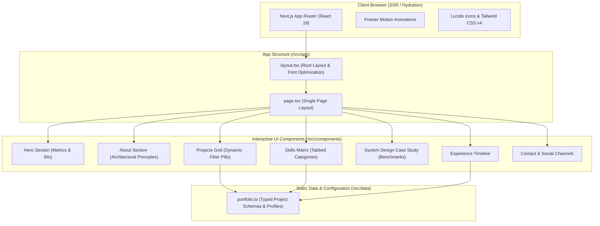

# Distributed Systems & Full-Stack Portfolio

A high-performance, responsive portfolio web application built with **Next.js 16 (App Router)**, **React 19**, **Tailwind CSS v4**, and **Framer Motion**. Designed to showcase large-scale distributed architectures, low-level design patterns, enterprise microservices, and production web applications.

---

## 🏛️ System Architecture



---

## 🚀 Key Features & Highlights

1. **Next.js 16 App Router & React 19**: Leverages Server Components, layout streaming, and zero-bundle hydration optimizations.
2. **Interactive System Design Case Study**: Deep dive into real-world distributed bottlenecks, before-and-after throughput benchmarks, and architectural resolutions.
3. **Dynamic Project Filtering**: Filter enterprise projects by category (*Distributed Systems*, *FinTech*, *Real-Time*, *Full-Stack*).
4. **Experience Timeline**: Career history with role impacts, quantifiable metrics, and tech stack tags.
5. **Interactive Skills Matrix**: Tabbed navigation across *Distributed Systems*, *Backend Architecture*, *Cloud & DevOps*, and *Databases*.
6. **Ultra-Responsive UI**: Fully accessible design with dark-mode ambient glows, smooth scrolling, and mobile drawer navigation.

---

## 📁 Project Structure

```
portfolio/
├── src/
│   ├── app/
│   │   ├── favicon.ico
│   │   ├── globals.css          # Tailwind CSS v4 directives & theme variables
│   │   ├── layout.tsx           # Metadata, viewport, and root HTML shell
│   │   └── page.tsx             # Main page composing sections
│   ├── components/
│   │   ├── Hero.tsx             # Hero banner with metric counters
│   │   ├── About.tsx            # Engineering philosophy and principles
│   │   ├── Skills.tsx           # Categorized tech competencies
│   │   ├── Projects.tsx         # Filterable portfolio project gallery
│   │   ├── SystemDesignCaseStudy.tsx # Distributed architecture deep-dive
│   │   ├── Experience.tsx       # Timeline of professional roles
│   │   ├── Contact.tsx          # Direct contact info and form
│   │   ├── Navbar.tsx           # Sticky navigation with mobile menu
│   │   ├── Footer.tsx           # Footer with links and back-to-top
│   │   └── Icons.tsx            # Custom SVG icons
│   ├── data/
│   │   └── portfolio.ts         # Centralized data model (projects, skills, roles)
│   └── lib/
│       └── utils.ts             # Tailwind class merging (clsx + twMerge)
├── public/                      # Static assets & icons
├── package.json
└── tsconfig.json
```

---

## 🛠️ Getting Started

### 1. Prerequisites
- **Node.js**: v18.0.0 or later
- **npm**: v9.0.0 or later

### 2. Installation
```bash
npm install
```

### 3. Run Development Server
```bash
npm run dev
```
Open [http://localhost:3000](http://localhost:3000) in your browser to view the application.

### 4. Build for Production
```bash
npm run build
npm run start
```

### 5. Lint & Typecheck
```bash
npm run lint
```
